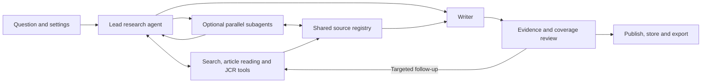

# Astro DRA


Astro DRA is a research assistant built on [Local Deep Research](https://github.com/LearningCircuit/local-deep-research). It combines literature search, evidence collection, source-aware writing, and report publication in a Docker deployment. Models connect through an OpenAI-compatible endpoint. The biomedical search path uses PubMed and Europe PMC alongside SearXNG web search.

## Technical stack

| Layer | Implementation |
| --- | --- |
| Web application | Flask routes, Jinja templates and JavaScript. Flask-SocketIO streams research progress to the browser. |
| Research execution | Python workers use a per-job settings snapshot. LangChain exposes typed tools and LangGraph runs the research agent's model and tool loop. |
| Model gateway | The `openai_endpoint` provider supports text, tool calling, and streaming for compatible models. |
| Search and reading | SearXNG for general web search, and PubMed and Europe PMC for bibliographic queries, abstracts, and links to article text. |
| Persistence | Per-account SQLite storage with SQLCipher when available, plus Docker volumes for app data and configuration. The app saves research jobs, reports, source metadata, and chat history. |
| Deployment | Docker Compose starts the application and SearXNG. The application image uses a pinned upstream image and installs DRA overlays at build time. |

The pinned upstream image supplies the app framework and its runtime dependencies. The [overlay manifest](deployment/overlay-manifest.json) maps each replacement file to its installed path. The [installer](deployment/install_overlays.py) also installs the `research_verify` package and applies the DRA settings defaults. The [account installer](deployment/install_accounts.py) adds the role and account hooks.

## Agent architecture



- **Lead agent.** The model reads the user's request, makes queries, chooses tools, and decides when to stop searching. Search calls can register inclusion criteria, facts to extract, and delivery requirements anchored to the user's wording. The collector carries those requirements into evidence acquisition and synthesis. Report size is a delivery requirement. Inclusion checking is triggered by the task's actual criteria.
- **Subagents.** The lead can call `research_subtopic` with focused questions. Each question gets its own agent conversation using the same model and an independently tracked set of accessed material. The workers share source numbering and deduplication. As results become available, they return a research map, links and source IDs, and located original excerpts. The lead can collect one result while other work is still pending.
- **Writer and reviewers.** The writer receives the draft, a budgeted source view, and the recorded limits of that view. Separate model calls check factual support, coverage of the request, and proposed repairs. The program checks source identifiers, quote locations, and the boundaries of proposed local edits.

The main entry is [`LangGraphAgentStrategy`](local_deep_research/langgraph_agent_strategy.py). See [subtask execution](local_deep_research/research_verify/subtask_research.py), [subtask handoff](local_deep_research/research_verify/subtask_handoff.py), and the [prompt inventory](docs/README-prompts.md) for the actual instructions.

### Execution budgets

| Setting | Default behavior |
| --- | --- |
| Main LangGraph loop | 50 model/tool cycles as the normal budget. The web path passes `search.iterations` to the agent, which falls back to 50 when the value is below 10. The model can finish early. |
| Delegation | The prompt suggests 2–5 questions. The tool accepts up to 10 per batch. The worker pool defaults to 4 concurrent subagents, with a ceiling of 5 and a queue for remaining questions. |
| Subagent loop | 8 model decisions per subtask by default. Up to 7 are for research, with one reserved for delivery when needed. |
| Source registry | Up to 500 unique sources in the default deployment. Repeated hits can reuse a source ID. |
| Detailed reports | An outline call returns sections and subsections. Each subsection runs a short research pass with a 1-cycle budget. The Compose defaults allow 300 seconds per subsection and 900 seconds for the detailed report. |
| Writer input | The source material budget is configurable up to 200,000 characters. Large reports can be written in parts. |

The displayed search-iteration count increments on model steps. A step can request multiple tools, so network search traffic is best measured from tool calls.

## Research pipeline

1. **Start the job.** The web route checks access, captures settings and creates a research record. The worker runs the research strategy and emits progress. Ordinary reports, detailed reports and scheduled jobs share the publication path. [Research service](local_deep_research/research_service.py) · [Detailed reports](local_deep_research/overlay/report_generator.py) · [Scheduler](local_deep_research/overlay/scheduler_background.py)
2. **Build and screen queries.** Search tools accept topic text, structured groups of synonyms, or an explicitly marked database-native query. The search adapters compile supported fields into the target database syntax. The relevance model screens preview batches against the task. Candidates from failed batches can continue with an incomplete-screening status, and equivalent inputs can reuse a screening decision within the job. [Query compilation](local_deep_research/research_verify/task_plan.py) · [Batch screening](local_deep_research/overlay/relevance_filter.py)
3. **Register sources and retrieve evidence.** The collector associates a stable citation number with known identifiers such as DOI, PMID and PMCID. Full-text tools keep the acquired text and can ask a model to select relevant windows. The program copies the chosen passages verbatim from the acquired text and records character offsets and acquisition scope. A gap in the acquired excerpt stays scoped to that excerpt. [Source collection](local_deep_research/research_verify/source_collection.py) · [Article fetching](local_deep_research/overlay/fetch_tools.py) · [Passage selection](local_deep_research/research_verify/semantic_evidence.py)
4. **Check inclusion and journal metrics.** Evidence is assessed against explicit inclusion criteria for the same paper. When the request needs an impact factor, the lead can call `search_journal` for relevant candidates, with the intended use, year, and any cutoff or sort direction. The tool binds the lookup to the collected source, uses ISSN or a normalized exact journal name, and records the metric year and status. Journal values may be reused for the same catalog revision. Thresholds are evaluated for the current task, and IF sorting requires the requested direction. [Eligibility](local_deep_research/research_verify/task_eligibility.py) · [JCR adapter](local_deep_research/research_verify/jcr_adapter.py)
5. **Assemble the writing input.** The writer gets source IDs, the actual abstract or selected article text, reading notes, applicable eligibility and JCR receipts, and the lead's draft for organization. Reading notes retain quoted subjects, qualifiers, and limits. If generation reaches the provider's output limit, bounded continuation requests must reproduce an exact anchor before additional text can be joined. [Writer context](local_deep_research/research_verify/generation.py) · [Source reading](local_deep_research/research_verify/source_reading.py) · [Writer continuation](local_deep_research/overlay/base_citation_handler.py)
6. **Review and fill gaps.** Fact checking groups report claims with their cited material. Coverage review separately locates each quoted report passage and asks the model to judge coverage against the user's original request. Each verdict has a scope. The model can request an article reread or a web lookup for an unresolved question. A completion needs verifiable new source text and independent confirmation. Unresolved findings remain visible in review records. [Review orchestration](local_deep_research/research_verify/evidence_flow.py) · [Task coverage and follow-up](local_deep_research/research_verify/task_evidence.py)
7. **Publish and store.** Publication reconciles inline citation numbers with the source registry and bibliography. Citation intervals are expanded by source identity before renumbering. Web display and exports read the stored publication mapping. The default deployment enables native fact-consistency review. The separate saving-time citation audit has its own switch and defaults to off. [Publication](local_deep_research/research_verify/publication.py) · [Citation display](local_deep_research/research_verify/citation_display.py) · [Report storage](local_deep_research/overlay/database_storage.py)

The system can establish that an excerpt was located and identify what material a reviewer received. Search coverage, full-text acquisition, and semantic support still depend on the sources available and the quality of model judgments. Current gaps and validation results are in [Evidence selection](docs/README-evidence-selection.md) and [Development progress](docs/development-progress.md).

## Memory and trace data

| Scope | What persists and how it is used |
| --- | --- |
| One research job | LangGraph keeps the current conversation and tool observations. The application stores the source registry, task requirements, screening decisions, and lookup receipts for the run. A detailed report can reuse the source numbering and pass recent written sections to the next section. |
| Follow-up in the same chat | The app stores chat messages and progress rows. The follow-up route loads a window of 20 recent entries. The default `summary` mode focuses up to roughly 7,500 characters of history on the new question and limits the summary to 8 sentences and 2,000 characters. The contextual follow-up strategy passes the summary and new request to the configured research strategy. The other modes are `raw`, `full` for the loaded window, and `none`. |
| Across research jobs | Previous reports are available from the account's history. An independent job starts from its own request. Enabled library or collection tools can retrieve stored documents. The JCR cache reuses journal metric values by catalog revision. |
| Diagnostics | When enabled, private research traces under `/data/research_traces/<research-id>/` preserve tools, source and writer snapshots, review decisions, and publication metadata. The OpenAI-compatible debug transport can also store provider-returned reasoning fields in `model-reasoning/`. These receipts serve operational diagnosis. |

See [Prompt inventory](docs/README-prompts.md) for the follow-up and summarization templates, and [Debug capture](docs/fine-grained-debug-capture-20261118.md) for trace switches, limits and receipt formats.

## Repository layout

| Path | Purpose |
| --- | --- |
| [`compose.yaml`](compose.yaml), [`deployment/`](deployment/) | Deployment entry point, image build, overlay map, account hooks, and SearXNG configuration |
| [`local_deep_research/`](local_deep_research/) | Installed application patches, verification modules, and project tests |
| [`local-deep-research/`](local-deep-research/) | Vendored upstream source snapshot with a separate development environment |
| [`docs/`](docs/README.md) | Prompt inventory, implementation records, and operations notes |
| [`ldr-monitor/`](ldr-monitor/) | Deployment diagnostics and historical operational notes |

For deployed changes, edit the patches under `local_deep_research/` and rebuild the image. The vendored snapshot is useful for following upstream interfaces. See [Source layout](docs/source-layout.md).

## Deployment

Requirements are Docker Engine, the Docker Compose plugin, and a reachable OpenAI-compatible model endpoint. Run from the repository root.

```bash
cp .env.example .env
python -c 'import secrets; print(secrets.token_hex(32))'
# Edit .env to set the model endpoint, model name, credentials and SEARXNG_SECRET.
docker compose config --quiet
docker compose up -d --build
docker compose ps
```

Open <http://localhost:5001> with the example settings, or use the port in `LDR_PORT`. Compose defaults to port 5000 when that variable is unset. The example binds to loopback. Create the initial account in the web interface. User data and configuration live in the `ldr_data` and `ldr_config` named volumes. See [Deployment](docs/deployment.md) for remote access, backup and migration.

- Set `LDR_LLM_OPENAI_ENDPOINT_URL` and `LDR_LLM_MODEL` for the provider. Supply credentials through your private environment.
- For impact factor lookup, supply a readable JCR SQLite catalog in the data volume at `/data/journal_data/jcr.db`, or set `LDR_JCR_CATALOG_PATH` to its path inside the container. [JCR catalog setup](local_deep_research/research_verify/jcr_mcp/README.md)
- Debug capture is a deployment choice. Set `LDR_RESEARCH_TRACE_ENABLED` for research traces. Use the container environment for `LDR_APP_DEBUG` or `LDR_REASONING_CAPTURE` when provider reasoning capture is needed. Protect the data volume, including `/data/logs/user_questions.log`, which stores submitted questions separately from file logging. [Debug capture](docs/fine-grained-debug-capture-20261118.md)

```bash
docker compose logs --tail=100 local-deep-research
docker compose stop
```

## Testing

Run the overlay suite against the built runtime so the tests see the same upstream imports and installed patch layout as the application.

```bash
docker compose run --rm --no-deps --entrypoint /bin/sh \
  -v "$PWD:/work:ro" -w /work local-deep-research -ec '
    /usr/local/bin/pip3 install --target /tmp/dra-testdeps -r requirements-test.txt
    PYTHONPATH=/tmp/dra-testdeps:/work:/work/local_deep_research \
      /install/.venv/bin/python -m pytest -q -p no:cacheprovider local_deep_research/tests
  '
```

Provider and search connectivity, publication of a full report, and report quality can also be checked with logged end-to-end research runs. The [development log](docs/development-progress.md) records those runs, the fixtures used, and known test failures.

The upstream project is [LearningCircuit/local-deep-research](https://github.com/LearningCircuit/local-deep-research), licensed under MIT. See [LICENSE](local-deep-research/LICENSE).
