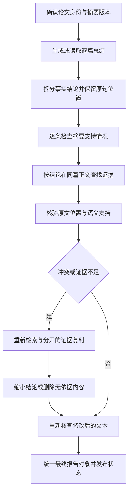

# 论文总结的摘要比对与幻觉核验方案评估

日期：2026 年 10 月 20 日。对象：Astro DRA 的逐篇论文总结及最终综合报告。

调研与问题复现对应修改前的 Git 基线 `115e2638fb89d643a0afb8f80134b627e6aa323a`。文末记录随后授权实现的首轮迭代；历史探针及其 JSON 保留修改前快照，不用作当前版本的测试入口。

建议保留“先与摘要比较，发现问题后再复核”的方向，将比较对象改成总结中的原子结论，并把摘要匹配作为分流依据。高匹配只能说明摘要可能支持相关结论；低匹配应触发正文查证。正式通过需要逐条证据、证据定位和发布前复核。

原方案需要修改；修订方案具备工程接入条件，值得先做离线验证。真实任务中的误判率、中文适配和额外成本仍需实测。本次完成文献调研、代码核查、确定性问题复现和方案可行性复审，没有运行检测模型的准确率实验。

## 原思路的适用范围

“论文核心内容通常会在摘要出现”可以作为筛查先验，不能直接推出“与摘要相似的总结没有幻觉”。需要区分四件事：主题是否相关、原文是否支持、重要信息是否完整、论文结论在现实中是否成立。本次主要解决第二件事，即总结对被引论文的忠实程度。

以下是构造的逻辑反例，不是实测模型输出或相似度分数。

| 摘要或正文情况 | 总结的变化 | 整体相似度的局限 | 应采取的动作 |
| --- | --- | --- | --- |
| 摘要说方法没有显著改善结果 | 总结说方法显著改善结果 | 改动很少但结论反转 | 检查否定、统计显著性和方向 |
| 摘要报告提高 5% | 总结写提高 50% | 主题和大部分词语相同 | 检查数字、单位及比较基线 |
| 摘要只说两个变量相关 | 总结写其中一个导致另一个变化 | 相似主题掩盖因果强度变化 | 检查研究设计和因果措辞 |
| 方法参数只在正文出现 | 总结准确描述该参数 | 摘要无法提供支持 | 查正文，不能直接认定幻觉 |
| 十条结论中九条正确，一条关键结论错误 | 总结总体贴近摘要 | 平均分可能掩盖关键错误 | 逐条核验，关键错误阻止通过 |
| 总结复制另一篇相近研究的细节 | 细节听起来符合领域知识 | 主题正确但归属错误 | 只使用当前论文的证据 |

“没有在摘要找到证据”应标记为证据不足；“原文明示相反”才是冲突。未经本项目数据校准的匹配分数，也不能解释成幻觉概率，例如 0.8 分不意味着 20% 的幻觉概率。

## 文献调研与可借鉴的方法

以下按与任务的关系选择方法，不作最新性能排名。会议身份以官方论文集为准；表中的接入建议是针对本项目的工程判断。

| 方法与发表信息 | 核验到的方法内容 | 对当前方案的启示和边界 |
| --- | --- | --- |
| [SciFact，EMNLP 2020 主会](https://aclanthology.org/2020.emnlp-main.609/) | 用科学论文摘要核验科学主张，区分支持、反驳和证据不足，并定位理由句 | 与摘要核验最接近。支持采用带证据的分类，但不能据此推断摘要足以验证正文细节。参见论文第 3 至 4 节 |
| [FActScore，EMNLP 2023 主会](https://aclanthology.org/2023.emnlp-main.741/) | 将长文本拆成原子事实，再计算有可靠来源支持的比例 | 借鉴拆分和逐条核验。其主要实验是人物传记，不能把论文报告的误差直接当作科研总结的误差。参见第 3 至 4 节 |
| [AlignScore，ACL 2023 主会](https://aclanthology.org/2023.acl-long.634/) | 学习信息对齐，将来源分块、输出分句，聚合局部支持分数 | 适合作为英文事实一致性评分对照；与普通向量余弦相似度不同。项目中仍须保存逐条结果，避免平均分掩盖错误。参见第 3 节 |
| [FENICE，Findings of ACL 2024](https://aclanthology.org/2024.findings-acl.841/) | 从总结抽取原子结论，通过自然语言推断对齐来源中的句子及更长区段 | 为“原子结论加证据检索”提供更直接的总结评估依据；不是只比两段文本的整体相似度。其长文本补充实验包含英文叙事文本，不代表科研中文任务已验证。参见第 3 节和第 4.4 节 |
| [MiniCheck，EMNLP 2024 主会](https://aclanthology.org/2024.emnlp-main.499/) | 用专用事实核验模型判断文档是否支持结论；论文给出 770M 参数的 Flan T5 版本 | 可作为专用判定模型候选。二分类的“不支持”不能直接细分成“矛盾”或“原文没提到”；论文明确指出英文训练和跨文档推理评估的限制。参见第 2 节及 Limitations |
| [Chain of Verification，Findings of ACL 2024](https://aclanthology.org/2024.findings-acl.212/) | 草稿后生成核验问题，分开回答，再修订答案 | 复核应重新回答证据问题，减少草稿对判断的影响。这里仍应提供论文证据，不能仅让模型凭自身知识再次确认。参见第 3 节 |

由这些方法推导出的设计选择是：用摘要检查主要贡献是否被准确复述，用逐条证据判断细节能否成立，用分开的核验调用处理争议。上述论文没有证明这个组合在 Astro DRA 上的效果，需要项目内对照实验。

## 当前代码与可复现问题

实际部署补丁位于 `local_deep_research/`。旁置的 `local-deep-research/` 上游源码不会自动进入根目录构建的镜像，接入范围应遵守[源码布局](source-layout.md)和现有[严格文献验证工程计划](ldr-verification-engineering-plan.md)。

| 代码位置 | 当前行为 | 对幻觉核验的影响 |
| --- | --- | --- |
| `research_verify/citation_qc.py::extract_claims` | 仅提取带数字引用的句子 | 无引用的事实陈述不会被检查；尚未形成原子结论级覆盖 |
| `CitationQc._check_one` | 按 `full_content → abstract → snippet → body` 选择首个非空字段 | 有摘要时可能忽略正文；没有清楚区分证据类型和阅读范围 |
| 同一方法 | 每篇来源只取开头最多 1500 个字符 | 正文较后位置的相关结果不可见，摘要也可能被截断 |
| 同一方法 | 多篇引用片段合并，输出一个总体判定 | 一篇提供支持可能掩盖另一篇错引，缺少逐篇关系 |
| `CitationQc._judge_claim` | 接受模型返回的 `supporting_fragment` | 没有验证引文是否存在于来源中，也没有保存可靠偏移 |
| `langgraph_agent_strategy.py::_attach_citation_qc` | 使用当前 `self.model` 判卷，给正文加标注和附表 | 没有专用复核模型配置，也没有完成删除、改写和复核闭环 |
| `_finalize` 中的报告出口 | QC 表被追加到 `current_knowledge`；该路径的正文来自 `synthesized_content` | 追加核查表不能证明实际交付正文已修订，仍需统一发布对象 |

已用当前模块复现四项确定性缺口：无引用句被遗漏、1500 字符后的证据不进入提示词、不存在的模型引文仍可保留 `supported`、摘要优先于 `body`。复现使用人为固定的判卷响应，证明的是校验缺口，不是模型的幻觉发生率。复现脚本和含源码 SHA256 的结果分别见 [脚本](evidence/abstract_summary_probe.py)和[结果](evidence/abstract-summary-probe-results.json)。

原有 `test_citation_qc.py` 的 8 个测试函数通过直接调用全部通过，说明现有用例尚未覆盖这些缺口。本次使用 PATH 中可用的 Python 3.10.9；临时环境的 pytest 启动出现退出码 139，一次故障栈定位到 `readline` 导入。因此没有把这次检查记成 pytest 套件通过，也不作为仓库要求的 Python 3.12 至 3.14 环境验收。

## 修订方案

建议流程为：

### 摘要核验逐条执行

每条事实结论保存其原始中文或英文文本、总结中的位置、`paper_id`、结论类型、重要性，以及对应的摘要证据位置。结论类型至少区分研究对象、方法、结果、数值、局限和推断。

摘要层输出 `supported`、`contradicted`、`insufficient_evidence` 三种语义状态；缺摘要、身份不符、截断、服务失败另用明确原因记录。`supported` 表示当前摘要支持这条结论，不表示整篇总结无幻觉。

模型判定前后都要检查对象、数值、单位、方向、否定、实验条件和因果强度。规则负责发现明确不一致或提出待查项，不能仅因单位写法不同就拒绝，应保留等价换算和原文定位。

另行检查摘要中的主要贡献是否被总结覆盖。它用于发现遗漏，不能与事实支持率混成一个分数，也不能要求每篇针对用户问题的定向总结复述整段摘要。

### 正文核验保留严格准入要求

在同一篇论文的正文按结论检索句子、段落和必要的图表说明，同时查看限制条件及可能的反面证据。摘要不支持的方法细节可以由正文支持；不要强迫模型把真实细节删到只剩摘要内容。

当前工程计划要求正式证据经过全文检查。因此默认严格模式中，摘要高分也要继续正文核验，并继续满足文献身份、年份、JIF、语种和正文关键词等既有条件。摘要比对不改变这些准入规则。只有摘要可读时，可以呈现“摘要提及”的阅读线索，不能把论文标成严格核验通过。

摘要与正文冲突时，检查是否混用了预印本和正式版、正文是否完整以及限定条件是否遗漏；冲突未解则保持待核验。检索不到证据也不等于事实一定错误，必须区分“未找到”和“已找到反证”。

每个结论和每篇被引论文分别建立关系。综合判断可使用多篇论文共同提供的子证据，但不能用另一篇的证据替代当前论文总结的依据。

### 证据引文先校验再接受

每段引文必须在指定版本的原文中存在，保存内容哈希、章节或页码、起止位置和证据类型。仅允许可追溯的空白、断词等文本归一化；不能用模糊匹配把改写当成原文引文。

引文存在只证明来源真实，还要判断它是否支持整条结论。跨句证据保存多个定位，核验模型不得补造缺失实验条件。数字、对象或范围只被部分支持时，先缩小表述，再核验新版本。

### 分开的复判与有限修订

复判输入为结论、已核验来源和定位片段，不提供生成模型为草稿辩护的说明。提示模型输出结构化判定、证据和简短理由，不索取隐藏思维链。

证据不足时先补检索，冲突时查版本和上下文。确定无支持的事实删除；有部分支持的事实按证据改写。建议最多修订两次，并受任务预算限制；仍不能确认则返回已核验部分和缺口，不回退到旧草稿。

关键结论、数字、否定或因果变化、跨语种表述需要重点复判。若以后只对低分项调用较强模型，还须抽查高分项，监测错误放行；正式发布前所有保留的事实结论仍需完成规定的证据核验。

### 发布以实际交付文本为准

逐篇总结通过后，综合报告可能引入新的比较、推断和因果陈述，因此最终报告还要核查。推断和建议单独标明，不冒充某篇论文直接得出的事实。

核验结果绑定最终文本哈希。改写、翻译或合并后重新检查发生变化的结论；普通报告、详细报告、保存、API 和导出共用最终对象。任何出口都不能绕过待核验状态。

## 判定模型与决策方式

第一版宜复用现有可调用模型，在分开的调用中执行证据判定，优先实现数据与发布约束。缺少项目标注数据时，额外训练决策树或堆叠多个大模型，无法证明比明确规则更可靠。

| 候选 | 输入与输出 | 已核验的开放资源 | 接入判断 |
| --- | --- | --- | --- |
| 现有可调用模型的证据判定模式 | 原子结论、单篇证据、定位；输出状态与短理由 | 当前代码已有 `invoke` 接口；本次未进行真实模型推理 | 接入改动较少，适合先测中文。分开调用有助于控制上下文，不能视作独立正确性的保证 |
| MiniCheck Flan T5 Large，770M | 文档与结论；输出支持二分类及分数 | [论文链接的作者仓库](https://github.com/Liyan06/MiniCheck)已核验；[作者模型页](https://huggingface.co/lytang/MiniCheck-Flan-T5-Large)及[权重文件列表](https://huggingface.co/lytang/MiniCheck-Flan-T5-Large/tree/main)可见 | 可作英文专用模型对照；论文明确只用英文训练，中文总结不能直接套用性能。权重页标 MIT，代码仓库为 Apache 2.0，需分别固定版本 |
| AlignScore base 或 large，125M 或 355M | 来源文本与结论；输出事实一致性分数 | [作者仓库](https://github.com/yuh-zha/AlignScore)链接的[权重文件列表](https://huggingface.co/yzha/AlignScore/tree/main)可见，模型页标 MIT | 适合作为英文对照；作者环境较旧，建议独立服务或环境，先验证与当前 Python 的兼容性 |

上述两个专用模型的资源状态为 `author_link_verified`、权重 `file_listing_verified`、推理 `not_tested`；未下载权重，不据文件可见性推断本机已可用。MiniCheck 的 7B 变体有单独使用条件，不能套用 Flan T5 版本的许可判断。

中文总结与英文论文的主路径应保留原始文本进行跨语种评估。若用英文中间结论供英文专用模型评分，需要检查中间结论是否保留中文原意，并核查最终中文版本，防止翻译造成新的结论变化。

累积人工标注后，可以用逻辑回归或浅层决策树决定“需要复判还是证据足够”。特征可包括摘要支持分、正文支持分、证据完整性、数值或否定冲突、语言组合及模型分歧。先按论文分组划分数据，再在独立校准集上设阈值；不能只学习一个整体相似度阈值。硬性失败、证据缺失或版本冲突不能被综合分数抵消。

## 对修订方案的可行性复审

本节为本次评估中的反向检查，没有启动 research cycle 的独立角色控制器，不作为独立多智能体审阅。评审形式参考了 [WORKFLOW.md](/public/home/wangtk/software/research-cycle/WORKFLOW.md) 和[流程协议](/public/home/wangtk/software/research-cycle/references/protocol.md)中的来源定位、反例、修改回应和最低成本验证要求；本次未套用其正式研究运行的文献白名单。

| 复审问题 | 对第一版方案的影响 | 修订后的处理与剩余依赖 |
| --- | --- | --- |
| 高摘要分也会错误放行 | 否决“高分即无幻觉” | 逐条证据和关键错误阻断；模型误判仍需人工标注测量 |
| 正文真细节不一定在摘要中 | 否决“低分即幻觉” | 低支持转正文；全文不可得则保留待核验 |
| 严格模式本来就需要正文核验 | 摘要关卡可能只增加调用 | 比较有无摘要关卡的增量收益；无收益则缩为主要贡献检查 |
| 抽取原子结论时可能漏掉限定词或新造内容 | 拆分错误会污染后续核验 | 结论保留原句位置，检查拆分覆盖和语义等价，纳入人工评估 |
| 判卷模型也可能编造引文或认可错误 | 换模型不能修复证据约束 | 程序校验引文存在，语义另判；高分抽查，不以多数投票代替证据 |
| 检索只找支持证据会偏向确认草稿 | 可能漏掉正文中的反例和局限 | 查看相关上下文、结果和限制；版本冲突保持待核验 |
| 英文基准成绩不能代表中文总结 | 专用小模型的收益不确定 | 保留跨语种测试分层，必要时采用可处理中文的判定模型 |
| 只删除内容就能降低幻觉率 | 可能得到空洞或几乎空白的总结 | 同时报正确细节保留率、任务覆盖及证据不足比例 |
| 最终综合和翻译可能重新产生错误 | 逐篇通过不能等价为最终报告通过 | 绑定实际输出版本并统一报告出口，最后再核查 |

复审结论：修订方案可进入原型和离线验证。最有确定收益的工程工作是补齐结论覆盖、证据定位和发布约束；摘要关卡、专用小模型及额外决策模型是否带来增量收益，保持为待验证问题。

## 验证设计与实施顺序

### 对照实验回答摘要关卡是否有价值

先选约 20 篇代表性论文建立小规模试点，保留真实失败案例、正确总结和全文中有而摘要中无的细节。人工对原句中的事实结论及证据进行标注，复核全部争议和严重错误；不能把生成模型或判卷模型自己的判断当作真值。

| 组别 | 流程 | 要回答的问题 |
| --- | --- | --- |
| A | 当前代码流程 | 现有误通过和漏检基线是什么 |
| B | 原用户思路：整体摘要匹配加低分复核 | 简单关卡能发现多少错误，又遗漏什么 |
| C | 原子结论、正文检索、证据校验和最终复核 | 修复基础证据链本身的收益是什么 |
| D | C 加摘要逐条检查与分流 | 摘要关卡相对 C 是否值得增加 |
| E | D 中以专用小模型替代部分判定，再复判疑难项 | 增加判定模型能否在同等质量下节省成本 |

在 B 的开发集中选择并冻结相似度阈值，不能在测试结果出来后调整。试点可扩展至约 60 篇；开发、阈值校准和最终测试按论文及版本分组隔离，同篇改写不能跨集合。自然发生的错误和人为构造的数字、否定、因果等错误分别报告，人为错误分布不能用来估计线上幻觉发生率。

至少记录以下指标，并区分中英组合、全文可得性和错误类型：

- 错误结论误通过率：被判为支持的错误结论数除以全部已标注错误结论数。
- 已通过结论中的错误比例：错误且被放行的结论数除以全部放行结论数。
- 原子结论抽取覆盖率、正确细节保留率、用户问题所需信息覆盖情况。
- 正文证据检索召回率、有效引文定位率、待核验比例和修订后再次出错情况。
- 完整任务耗时、P95 延迟、模型调用次数、token、全文获取率及服务成本。

质量比较应在相近信息保留率或相近成本下进行，置信区间按论文分组计算。小样本零误通过不证明零风险：仅在独立同分布的二项近似下，100 条错误结论全部被拦截，误通过率的一侧 95% 上界仍约为 3%；同论文结论的相关性还会削弱这个近似。

固定验收案例必须覆盖无引用事实、伪造引文、错数字或单位、否定和因果变化、引用错篇、摘要缺失、正文较后位置的证据、摘要外的正确细节、跨语种偏移及报告出口绕过。确定性校验要求伪引文和未完成状态不能通过；语义能力则报告真实样本结果和不确定性。

### 分阶段落地

| 阶段 | 具体改动 | 完成条件 |
| --- | --- | --- |
| 第一阶段 | 扩展 `ClaimCheck`，保存逐条结论、证据类型、定位、版本和状态；构建人工样本 | 原始陈述可追踪，缺失和失败有明确状态，确定性缺口可回归 |
| 第二阶段 | 在现有 M1 和 M2 的合格文献与正文基础上，实现摘要检查、逐篇正文检索和引文校验 | 摘要不能冒充全文；每条事实能关联到相应论文的证据 |
| 第三阶段 | 增加受预算约束的复判、改写及最终报告核验；统一出口 | 修订后的实际交付文本经过核查，待核验不能绕过发布 |
| 第四阶段 | 对比专用小模型与现有模型；数据足够后评估额外决策模型 | 在独立测试上证明质量、信息保留和成本的收益，再启用自动阈值 |

这一方案应作为现有工程计划 M3 的细化，依赖 M1 的文献身份和 M2 的可信正文。摘要、正文和搜索片段需要独立字段；不能在 `full_content` 中混装。建议新增摘要检查与证据检索模块，扩展现有模型对象和 `CitationQc`，并让 `_finalize` 与服务层使用相同的最终结果。

成本取决于论文数、每篇原子结论数、证据长度、批大小和复判比例。应分别记录抽取、摘要检查、正文检查、复判和修订成本；严格模式不会因摘要高分而省掉必需正文步骤。缓存按论文版本、内容哈希、结论、规则、模型和提示词版本隔离，不能复用旧文本的通过状态。

实施优先级为：先取得可审计证据并控制发布，再验证摘要分流的增量价值，最后决定是否引入专用小模型或学习式决策器。达到工程接入条件与证明减少真实任务幻觉，是两个分别验收的结果。

## 首轮代码迭代记录

已将摘要与正文分别检查、正文窗口检索、精确引文定位、逐引用判定、有限复判和改写复核接入部署补丁。未通过的陈述从研究正文移除，原判定及修改保留在审计记录；来源缺失、类型不明、预算耗尽和模型异常保持待核验。LangGraph 的各结果字段共用处理后的正文，服务保存优先使用该对象；详细报告完成整合后再核验。

实现见 [citation_qc.py](../local_deep_research/research_verify/citation_qc.py)、[evidence.py](../local_deep_research/research_verify/evidence.py)，配置及边界见[核验模块说明](../local_deep_research/research_verify/README.md)。正文类型需要明确声明，不按 `full_content` 的长度推断。默认复用现有模型，不下载额外权重。

本地核验模块及集成边界测试共 101 项通过，覆盖修改前四项缺口、中文标点、正文独有细节、逐篇错引、摘要正文冲突、预算耗尽、改写失败和报告出口。测试采用可控判卷响应，应用边界测试执行实际补丁方法并替代外围依赖；不等于完整应用或真实模型准确率验收。使用 Python 3.10.9，并在测试进程内以 `sys.modules['readline'] = None` 绕过本机原生 readline 崩溃，未改动全局环境。Compose YAML 已解析；当前账号无 Docker daemon 权限，且客户端没有 Compose 子命令，容器构建未验证。

本轮仍按句与分句抽取陈述，不具备完整语义原子拆解；复杂跨文献联合论证采用保守策略。可信全文获取与完整性、全部严格准入条件、真实模型的中英跨语种效果及调用延迟仍按原工程计划分别验收。当前测试入口为 [核验回归测试](../local_deep_research/tests/test_citation_qc.py)及[报告集成测试](../local_deep_research/tests/test_citation_qc_integration.py)。
